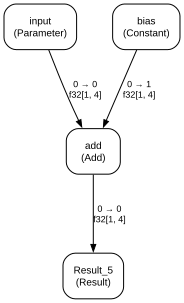
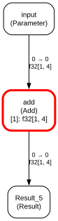
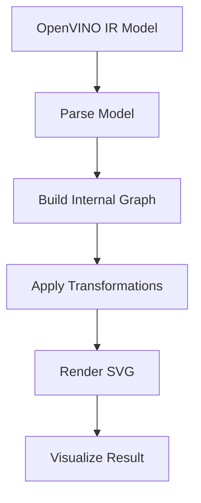

# Model Graph Visualizer

A Python tool for parsing OpenVINO Intermediate Representation (IR) models, converting them into a framework-independent graph representation, applying configurable transformation passes, and rendering the graph as an SVG image.

## Visual Preview

The following comparison shows the model graph before and after applying the transformation pipeline.

<table>
  <tr>
    <th align="center">Before Transformation</th>
    <th align="center">After Transformation</th>
  </tr>
  <tr>
    <td align="center" width="50%">
      
    </td>
    <td align="center" width="20%">
      
    </td>
  </tr>
  <tr>
    <td align="center">Original graph with all nodes visible.</td>
    <td align="center">Transformed graph with Constant nodes hidden and the add node highlighted.</td>
  </tr>
</table>


### Transformation Pipeline



The pipeline separates parsing, graph transformations, and rendering. This makes the graph easier to inspect and allows transformation passes to be configured independently.

## Features

- Parse OpenVINO IR models from XML and BIN files.
- Represent models as framework-independent directed graphs.
- Support unique node IDs, node attributes, visualization metadata, tensor shapes, data types, and input/output ports.
- Handle multiple inputs and outputs, duplicate node names, and dynamic tensor shapes.
- Apply configurable transformation passes in a specified order.
- Highlight selected nodes with a red border.
- Hide Constant nodes while preserving relevant tensor metadata on their consumers.
- Render top-to-bottom SVG graphs using Graphviz.
- Provide a command-line interface and Python API.
- Include automated tests and a 5,000-node synthetic benchmark.

## Requirements

- Python 3.11 or newer
- OpenVINO
- Graphviz system application and its Python package
- Pytest for running tests

## Installation

Clone the repository and navigate to the project directory:

```powershell
git clone https://github.com/AzizBenAli/intel_assignment.git
cd intel_assignment
```

Install the project and development dependencies:

```powershell
python -m pip install -e ".[dev]"
```

Install OpenVINO and the Python Graphviz package:

```powershell
python -m pip install openvino graphviz
```

Install the Graphviz system application from:

https://graphviz.org/download/

If Graphviz is installed in the default Windows directory, add it to the current PowerShell session's PATH:

```powershell
$env:Path += ";C:\Program Files\Graphviz\bin"
```

Verify that Graphviz is available:

```powershell
dot -V
```

## Quick Start

A small test model is provided in the `models` directory:

- `models/tiny_test_model.xml`
- `models/tiny_test_model.bin`

Generate an SVG graph:

```powershell
python -m model_graph.cli models\tiny_test_model.xml --output output\tiny_test_model.svg
```

Highlight the node named `add`:

```powershell
python -m model_graph.cli models\tiny_test_model.xml --output output\highlighted_graph.svg --highlight add
```

To generate the SVG used in the README preview, run:

```powershell
New-Item -ItemType Directory -Force docs\images
python -m model_graph.cli models\tiny_test_model.xml --output docs\images\tiny_test_model.svg
```

Open the generated SVG in a web browser to inspect it.

## Command-Line Usage

General syntax:

```powershell
python -m model_graph.cli MODEL.xml [OPTIONS]
```

### Options

| Option | Description |
|---|---|
| `--output`, `-o` | Output SVG path. Default: `graph.svg`. |
| `--highlight NODE_NAME` | Highlight a node by its exact name. Repeatable. |
| `--pass PASS_NAME` | Select a transformation pass. Repeatable; order is preserved. |
| `--no-passes` | Disable all transformation passes. |
| `--help` | Display command-line help. |

Available transformation passes:

- `highlight`
- `hide-constants`

### Examples

Generate a graph using the default pipeline:

```powershell
python -m model_graph.cli models\tiny_test_model.xml --output output\graph.svg
```

Highlight multiple nodes:

```powershell
python -m model_graph.cli models\tiny_test_model.xml --output output\highlighted.svg --highlight input --highlight add
```

Run only node highlighting:

```powershell
python -m model_graph.cli models\tiny_test_model.xml --output output\highlight_only.svg --pass highlight --highlight add
```

Run only Constant hiding:

```powershell
python -m model_graph.cli models\tiny_test_model.xml --output output\constants_hidden.svg --pass hide-constants
```

Disable all transformations:

```powershell
python -m model_graph.cli models\tiny_test_model.xml --output output\original_graph.svg --no-passes
```

Run Constant hiding before highlighting:

```powershell
python -m model_graph.cli models\tiny_test_model.xml --output output\custom_order.svg --pass hide-constants --pass highlight --highlight add
```

If no `--pass` options are specified, both passes run by default in this order:

1. Node highlighting
2. Constant hiding

When `--no-passes` is specified, all transformation passes are disabled.

## Python API

The main components can also be used directly from Python:

```python
from pathlib import Path

from model_graph import OpenVINOParser
from model_graph.renderer import SVGRenderer
from model_graph.transforms import (
    ConstantHidingPass,
    NodeHighlightingPass,
    PassPipeline,
)

model_path = Path("models/tiny_test_model.xml")
output_path = Path("output/api_graph.svg")

graph = OpenVINOParser().parse(model_path)

pipeline = PassPipeline()
pipeline.add(NodeHighlightingPass(["add"]))
pipeline.add(ConstantHidingPass())

transformed_graph = pipeline.run(graph)

SVGRenderer().render(transformed_graph, output_path)

print(f"SVG created: {output_path}")
print(f"Nodes: {len(transformed_graph.nodes)}")
print(f"Edges: {len(transformed_graph.edges)}")
```

## Graph Representation

The internal graph representation is independent of OpenVINO after parsing.

### Nodes

Each node contains:

- `id`: Unique identifier independent of its display name.
- `name`: Human-readable node name.
- `op_type`: Operation type, such as `Parameter`, `Add`, or `Constant`.
- `attributes`: Dictionary of operation attributes.
- `visualization`: Dictionary of rendering metadata.

### Edges

Each edge contains:

- `source_id`: ID of the source node.
- `source_port`: Output port on the source node.
- `destination_id`: ID of the destination node.
- `destination_port`: Input port on the destination node.
- `shape`: Tensor shape when available.
- `dtype`: Tensor data type when available.

The graph validates connections and maintains incoming and outgoing edge indexes. Removing a node also removes its incident edges.

Dynamic dimensions and unavailable metadata are handled without requiring fixed tensor shapes.

## Transformation Passes

### Node Highlighting

`NodeHighlightingPass` highlights nodes whose names match the configured names.

Highlighting is stored in visualization metadata, allowing the renderer to apply a red border without modifying the original OpenVINO model.

### Constant Hiding

`ConstantHidingPass` hides Constant nodes and stores relevant metadata on their consumers.

The metadata includes the consumer input port, tensor data type, and tensor shape when available. Shared constants can also be identified by their unique node IDs.

Tensor values are not included in the visualization metadata. Constant nodes are removed only when the transformation can preserve the relevant graph information.

### Pass Pipeline

`PassPipeline` executes enabled passes in registration order. This allows users to configure and compare different transformation sequences.

The parser creates the internal graph separately from the original OpenVINO model, so transformations operate on the graph representation rather than modifying the loaded model.

## Project Structure

```text
intel_assignment/
├── benchmarks/
│   └── benchmark_graph.py
├── docs/
│   └── images/
│       └── tiny_test_model.svg
├── examples/
│   └── test_highlighting.py
├── models/
│   ├── tiny_test_model.xml
│   └── tiny_test_model.bin
├── output/
├── src/
│   └── model_graph/
│       ├── parser/
│       ├── renderer/
│       ├── transforms/
│       ├── cli.py
│       ├── exceptions.py
│       ├── graph.py
│       └── model.py
├── tests/
├── pyproject.toml
└── README.md
```

## Testing

Run the complete test suite from the project root:

```powershell
python -m pytest
```

The tests cover graph operations, edge validation, OpenVINO parsing, node highlighting, Constant hiding, pipeline ordering, SVG rendering, and CLI argument handling.

## Benchmark

Run the synthetic 5,000-node benchmark:

```powershell
python benchmarks\benchmark_graph.py
```

Sample results from one local run:

| Metric | Result |
|---|---:|
| Initial nodes | 5,000 |
| Final nodes | 4,500 |
| Final edges | 4,499 |
| Graph construction time | 0.0423 seconds |
| Transformation time | 0.0167 seconds |

In this run, the transformation pipeline highlighted a selected node and removed 500 Constant nodes while preserving the connected chain of regular operations.

These measurements are from a synthetic graph and a single run. Execution times depend on hardware and graph structure; they do not measure model inference performance.

## Model Examples

### 1. Tiny Test Model

The project includes a small test model in `models/`. It is useful for checking parsing, graph connections, highlighting, Constant hiding, and SVG generation.

### 2. ResNet-50

ResNet-50 is a convolutional neural network commonly used for image classification. To visualize it, obtain or export a ResNet-50 model in OpenVINO IR format and pass its XML file to the CLI.

```powershell
python -m model_graph.cli path\to\resnet50.xml --output output\resnet50.svg
```

### 3. TinyLlama

TinyLlama is a compact language model that can be used to demonstrate visualization of a larger neural network graph. Obtain or convert a compatible TinyLlama model into OpenVINO IR format first.

```powershell
python -m model_graph.cli path\to\tinyllama.xml --output output\tinyllama.svg
```

The ResNet-50 and TinyLlama model files are not included in this repository. Ensure that the XML file references its corresponding BIN weights file and that the model is compatible with the installed OpenVINO version.

## Limitations

- Input models must be available in OpenVINO IR format.
- Large graphs can produce very large SVG files that are difficult to inspect in a browser.
- Visualization performance depends on graph size, layout complexity, and the installed Graphviz version.
- The tool visualizes model structure; it does not perform model inference or measure prediction accuracy.

## License

Add the license required by your assignment or repository before distributing this project.
